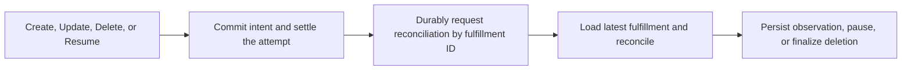

# Workflow boundaries

The managed-resource model treats an orchestration pass as one step and assumes
one active execution per fulfillment. Two smaller models check where the Go
source can violate those assumptions. A third checks the handoff contract
required to simplify the workflows.

| Model                                                 | Current boundary                                                                     | Checked result                                                                                                                       |
| ----------------------------------------------------- | ------------------------------------------------------------------------------------ | ------------------------------------------------------------------------------------------------------------------------------------ |
| [Delivery reports](delivery_reports.qnt)              | A terminal report commits before its completion signal is sent.                      | One failed signal can leave an acknowledged delivery waiting forever. A durable read of the full committed result restores progress. |
| [Workflow instance admission](workflow_instances.qnt) | The Postgres backend checks for an active instance before inserting a new execution. | Two concurrent starts can both become active. Active-row uniqueness prevents the counterexample.                                     |
| [Orchestration handoff](orchestration_handoff.qnt)    | A signal targets an execution that may already be exiting.                           | A wake bound to that execution can be lost. An instance-scoped pending run preserves ownership and progress in the model.            |

## Delivery completion

Follow `commitReport → failCompletionSignal → retryReport`. The result
transaction commits the terminal delivery state. If the subsequent signal
fails, a retry encounters the terminal state, returns success, and sends
nothing. The workflow has already received the acknowledgement, so it waits
without a timeout. Managed-resource maintenance tries to start orchestration,
but the waiting execution still owns the instance ID.
[ReportResult](../internal/application/delivery_report_service.go#L149) ·
[dispatchAndAwait](../internal/domain/orchestration.go#L1144) ·
[Maintenance dispatch](../internal/application/managed_resource_maintenance.go#L70)

Make the generation-scoped result durable in the same transaction as its
terminal state. Let the waiting workflow re-read it on a durable timeout and
use the signal to reduce latency. The result must include the data needed to
process provisioned targets and produced secrets. The terminal state alone
cannot reconstruct those outputs. The model represents one acknowledged
delivery and one failed completion signal, with an abstract output-processing
step after observation.
[DeliveryResult](../internal/domain/delivery.go#L295) ·
[ProcessDeliveryOutputs caller](../internal/domain/orchestration.go#L1105)

## One active execution

Fleet uses the Postgres backend when configured for Postgres. The pinned
go-workflows version checks for an active instance at `READ COMMITTED` and
inserts a row keyed by instance and execution ID. Both callers can observe no
active row, then insert with different execution IDs. Fleet's
`AcquireLockAndLoad` still returns the snapshot when the fulfillment's
orchestration marker is already present. Two owners can therefore proceed, and
a completion signal addressed by instance ID can reach either execution.
[Fleet backend selection](../internal/bootstrap/workflow.go#L19) ·
[AcquireLockAndLoad](../internal/domain/orchestration.go#L275) ·
[Upstream issue #489](https://github.com/cschleiden/go-workflows/issues/489)

The model compares that admission rule with a unique constraint on the active
instance ID. An implementation also needs to translate the winning insert's
conflict into `AlreadyRunning` and verify the constraint against
`ContinueAsNew` on the real backend. The model covers admission for two callers
under one logical ID.

## A shared workflow shape

Keep each command's preconditions and outcome. Create resolves its nonce,
Update checks the pinned revision and etag, Delete records removal intent, and
Resume refreshes authorization. Share the handoff after the command has settled.
The same fulfillment workflow owns the latest level and chooses apply, remove,
or pause. After successful removal, an idempotent finalization activity can
check readiness and delete the matching resource and fulfillment in one
transaction. That removes the separate cleanup listener and its notification.

The shared handoff can use today's primitives by reusing Update's bounded
retry and recheck after `AlreadyRunning`. For a smaller protocol, add one
backend guarantee, exposed as `RequestReconciliation(fulfillmentID)`. On
success, the backend has made a future pass runnable or durably recorded a
pending pass for the logical instance. Repeated requests coalesce. Claim the
pending request durably before loading the fulfillment. Serialize publication
with finishing the active execution so a request arriving after the last
generation check schedules a successor. Keep unclaimed work across
`ContinueAsNew`. This needs one pending bit per instance, or an equivalent
backend representation, together with unique active-instance admission.

Calling today's Start and then signaling the active run leaves the finish race.
The handoff model deliberately gives the running execution a last chance to
read the signal before it decides to exit. Publishing after that decision
still violates `publishedWorkHasOwner`. The pending-run variant satisfies that
invariant and fair progress with up to three generations and one continuation.

The command workflow still owns the gap between committing the domain write
and publishing the request. It retries or resolves ambiguity through its
nonce or pinned revision before handing off. Putting the wake in the same
transaction as the mutation would close that gap as well, with a wider
transactional scheduling interface. The handoff model assumes publication
eventually succeeds and leaves delivery result recovery to its own model.
